## Hi there 👋

<!--
**Noctoa/Noctoa** is a ✨ _special_ ✨ repository because its `README.md` (this file) appears on your GitHub profile.

Here are some ideas to get you started:

- 🔭 I’m currently working on ...
- 🌱 I’m currently learning ...
- 👯 I’m looking to collaborate on ...
- 🤔 I’m looking for help with ...
- 💬 Ask me about ...
- 📫 How to reach me: ...
- 😄 Pronouns: ...
- ⚡ Fun fact: ...
-->

<h2 align="left">Hi 👋! My name is Ugo Maddalena Chupin and I'm a developper from France</h2>

<h4 align="left">🏫 3rd year student at Epitech Nice 
🎮 Future game dev</h4>

###

###

    

###

  

###

<picture>
  <source media="(prefers-color-scheme: dark)" srcset="https://raw.githubusercontent.com/Noctoa/Noctoa/output/github-snake-dark.svg" />
  <source media="(prefers-color-scheme: light)" srcset="https://raw.githubusercontent.com/Noctoa/Noctoa/output/github-snake.svg" />
  
</picture> 
